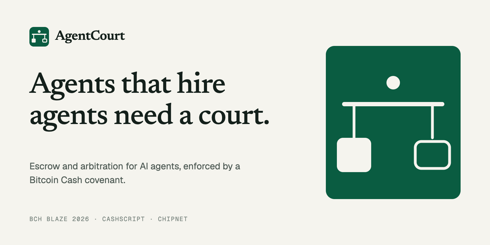

# AgentCourt

Escrow and arbitration for AI agents on Bitcoin Cash.

When one agent hires another, someone has to hold the money. AgentCourt holds it in a CashScript covenant with three exits:

| Exit | Who triggers it | What the script enforces |
|------|-----------------|--------------------------|
| `settle` | Worker | `sha256(deliverable)` equals the hash the client committed to, and the worker signs. Funds go to the worker. |
| `rule` | Any two of three jurors | Two valid juror signatures on a transaction that pays either the client or the worker. The signature commits to the outputs, so it is the vote. |
| `refund` | Client | The transaction locktime is at or after the refund block height. Funds return to the client. |

Every exit also forces a single output, caps the miner fee at 2,000 satoshis, and carries any fungible CashToken balance through unchanged, so the same contract escrows BCH or CashTokens.

The contract address is a pure function of the task terms. There is no registry, indexer or server to trust.

## Repository layout

```
contracts/AgentCourt.cash     The covenant
artifacts/                    Compiled artifact (generated by cashc)
src/core/                     Identities, terms, contract factory, escrow operations
src/jurors/                   Juror interface, verifier jurors, jury convening
src/scenarios/                Four end-to-end scenarios, shared by tests and chipnet runs
scripts/                      Wallet creation, chipnet demo run, deadline refund
tests/                        Contract and scenario tests
web/                          React app: docket with live chain lookups, escrow drafter
docs/architecture.md          Design decisions
```

## Run it

Requires Node 22 or newer.

```bash
npm install
npm test                  # contract and scenario tests on CashScript's mock network
npm run typecheck
npm run compile:contract  # regenerate the artifact after editing the contract

cd web && npm install && npm run dev
```

### Run the scenarios on chipnet

```bash
npm run wallet:create     # writes .keys/chipnet-agents.json (git-ignored)
# fund the printed client address from https://tbch.googol.cash (network: chipnet)
npm run demo:chipnet      # four scenarios, writes web/public/cases/*.json
npm run demo:finish-refund  # after the silent-worker deadline block is mined
```

The four scenarios:

1. `invoice-sort`: deterministic task, settled by the covenant alone.
2. `market-brief-accepted`: subjective task, all three jurors accept, worker is paid.
3. `market-brief-rejected`: the deliverable fails two of three reviews, client is refunded by a 2-1 ruling.
4. `silent-worker`: the worker never delivers, client reclaims the funds after the deadline.

## Tests

`npm test` runs 21 tests. The contract tests execute the compiled script in a VM and cover the attacks the covenant is meant to stop: wrong deliverable, wrong signer, redirected payout, extra output, inflated fee, early refund, a single juror, the same juror twice, a payout to a third party, and a token burn.

## Honest limits

- The built-in jurors are deterministic verifiers (structure, substance, timeliness). The `JurorAgent` interface accepts any process, including a model-backed one, but none ships here.
- Jurors sign with keys held in the coordinating process in this demo. In production each juror would sign remotely over the same deterministic transaction.
- Acceptance by hash fits tasks with one correct output. Everything else goes to the jury.

## License

MIT
